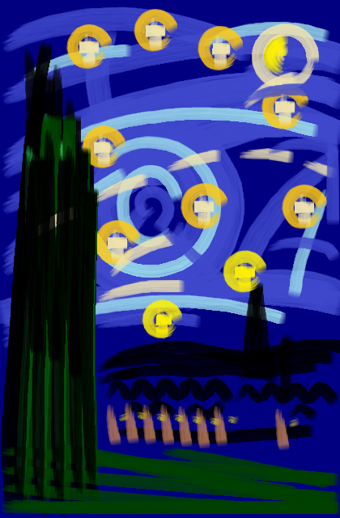

# Computer MCP

[简体中文](https://github.com/Sanjeever/computer-mcp/blob/main/README.zh-CN.md)

Computer MCP gives AI agents native desktop access over stdio MCP. Agents can observe windows through accessibility trees and screenshots, then click, type, scroll, or drag.

## Drawing with Computer MCP

| Windows 10 · Paint | Windows 10 · Paint | macOS · Freeform |
| :---: | :---: | :---: |
| [](https://raw.githubusercontent.com/Sanjeever/computer-mcp/main/docs/images/starry-night-paint.png) | [](https://raw.githubusercontent.com/Sanjeever/computer-mcp/main/docs/images/saturn-ringhaven-poster.png) | [](https://raw.githubusercontent.com/Sanjeever/computer-mcp/main/docs/images/freeform-postcard.png) |
| [Claude Code · The Starry Night](https://github.com/Sanjeever/computer-mcp/blob/main/docs/usage.md#recreating-the-starry-night-in-paint) | [Claude Code · Ringhaven poster](https://github.com/Sanjeever/computer-mcp/blob/main/docs/usage.md#drawing-a-saturn-travel-poster-in-paint) | [Codex · Lighthouse postcard](https://github.com/Sanjeever/computer-mcp/blob/main/docs/usage.md#drawing-a-postcard-in-freeform) |

## Connect

Requires **Node.js 22+** and a logged-in graphical session on **macOS 14+ (Apple Silicon)** or **Windows 10/11 (x64)**.

### Codex

Add this block to `~/.codex/config.toml`.

```toml
[mcp_servers.computer]
command = "npx"
args = ["-y", "@sanjeever/computer-mcp"]
```

The connection guide covers Windows launch with `cmd.exe`, language settings, and direct native launch. [Client configuration](https://github.com/Sanjeever/computer-mcp/blob/main/docs/usage.md#connect)

### Other MCP clients

Add this configuration to a client that accepts `mcpServers`.

```json
{
  "mcpServers": {
    "computer": {
      "command": "npx",
      "args": ["-y", "@sanjeever/computer-mcp"]
    }
  }
}
```

## Permissions

On macOS, grant the host or executable shown by System Settings **Accessibility** and **Screen Recording** access, then restart the MCP process. On Windows, use the target user's interactive session. Windows may block input to elevated apps. [Permission details](https://github.com/Sanjeever/computer-mcp/blob/main/docs/usage.md#permissions)

## Tools

Call `computer_status` to check access. Use `computer_window` to list windows and activate an exact `window_id`, then call `computer_observe`. Use the newest snapshot and its own image coordinates for pointer input. [Tool reference](https://github.com/Sanjeever/computer-mcp/blob/main/docs/usage.md#tools)

[User guide](https://github.com/Sanjeever/computer-mcp/blob/main/docs/usage.md) · [Development and release](https://github.com/Sanjeever/computer-mcp/blob/main/docs/development.md) · [Releases](https://github.com/Sanjeever/computer-mcp/releases) · [MIT license](https://github.com/Sanjeever/computer-mcp/blob/main/LICENSE)
